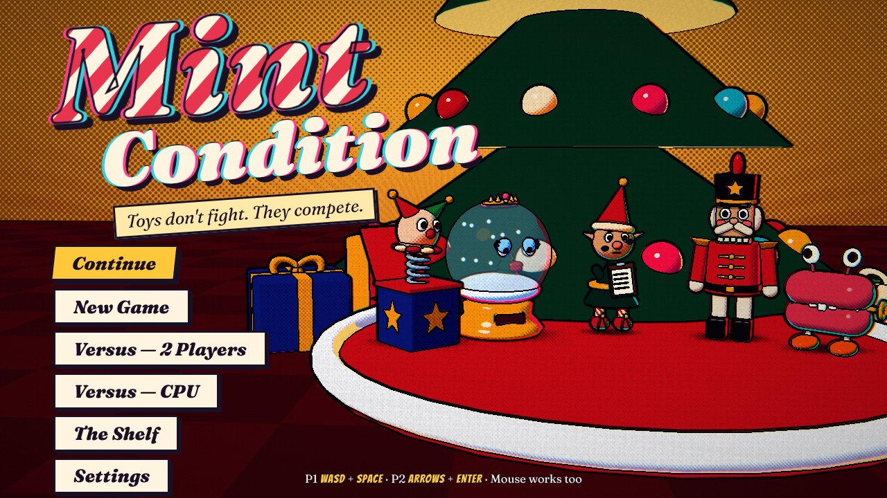
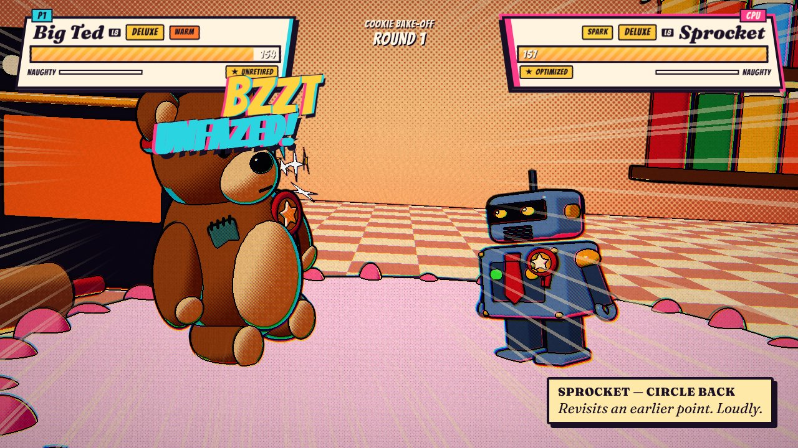
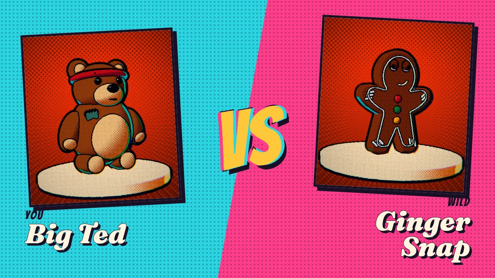
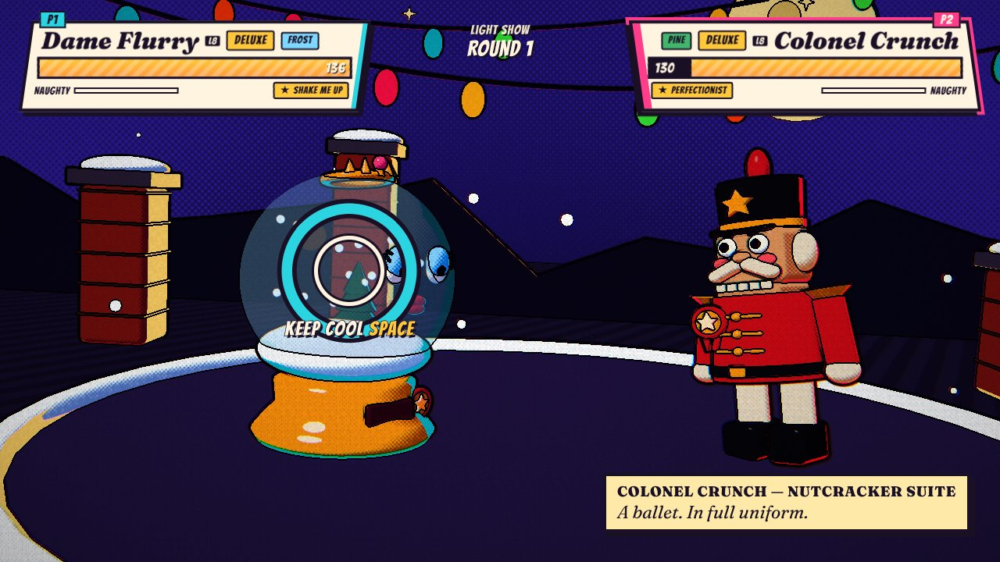
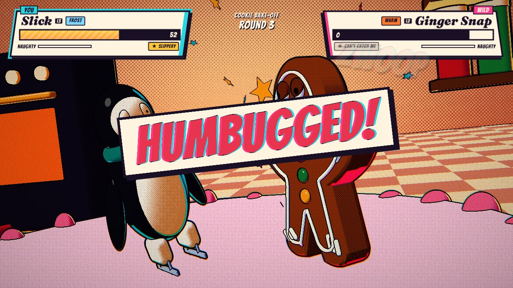
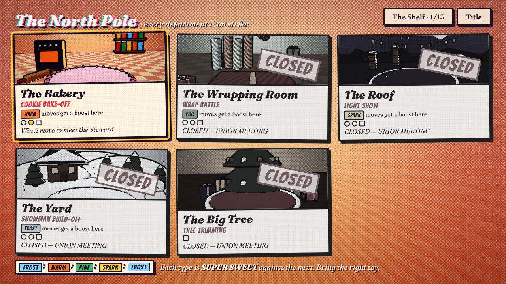
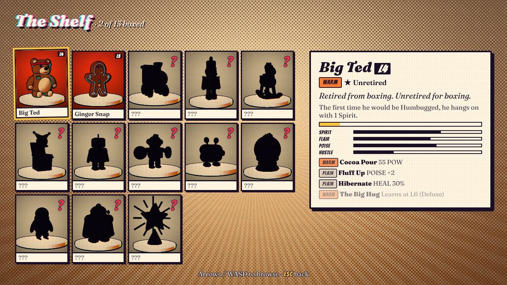

# Mint Condition

> The kids were good this year. All of them. The North Pole ran short on magic,
> so Oddrey was told to top up the Cheer Condenser. Oddrey topped it up.
> Every toy in the workshop woke up. Within the hour, they'd unionized.

A Christmas creature collector where the creatures are toys and the battles are
contests — cookie decorating, gift wrapping, light shows — played like a
fighting game. Every move is a two-second skill performance; every incoming hit
is a chance to keep your cool. Beat a toy at its own game and it gets in the box.



| | |
|---|---|
|  |  |
|  |  |
|  |  |

- **Story** — four departments and a finale, ~15 showdowns. Box all 13 toys.
- **Versus** — two players, one keyboard. Pick the contest, pick your toys, go.
  Or play the CPU.

## Controls

|  | Player 1 | Player 2 |
|---|---|---|
| Pick a move / rhythm lanes | `W` `A` `S` `D` | `↑` `←` `↓` `→` |
| Perform / Keep Cool / confirm | `Space` | `Enter` |
| Back | `Esc` | `Backspace` |

In single player either set works, and mouse/touch works everywhere.

## Run it

```bash
npm install
```

```bash
npm run dev
```

Open http://localhost:5173. There's also a dev-only toy lab at
`/lab.html?toys=bigTed,jack` and `/lab.html?arena=roof&toys=sprocket,cymon`.

| Script | What it does |
|---|---|
| `npm run dev` | Vite dev server |
| `npm run build` | Typecheck + production build to `dist/` |
| `npm test` | Unit tests (rules, progression, save, scoring, data/tone rules) |
| `npm run e2e` | Playwright against the production build; a page-side bot plays the real minigames |
| `npm run balance` | Simulates ~20k showdowns and prints the balance report (`-- --quick` for fewer) |
| `npm run curve` | Expected minigame scores by human timing error (how the windows were calibrated) |
| `npm run build:artifact` | One self-contained HTML file (for sharing as a claude.ai artifact) |
| `npm run lint` / `typecheck` | ESLint / tsc |

## Deploy (Vercel)

It's a static Vite build; `vercel.json` is included.

```bash
npx vercel --prod
```

Or import the repo in the Vercel dashboard — framework preset **Vite**, no
environment variables, no backend. Saves live in the player's `localStorage`.

## How it's built

```
src/core/      Pure TypeScript rules: battle, AI, campaign, save. No DOM. Deterministic.
src/render/    Three.js comic pipeline: materials, inking, post FX, toys, arenas, director.
src/app/       Preact screens + battle controller/HUD/minigames.
src/audio/     WebAudio-synthesised SFX (no music, no asset files), optional VO hook.
src/input/     Two-player keyboard mapping.
scripts/       Balance simulator.
tests/         Vitest unit tests + Playwright e2e with a bot.
```

The rules never touch the renderer: `core/battle.ts` returns events, and the
director/HUD play them. That's what makes the balance simulator and the tests
possible.

## Docs

- [Design](docs/DESIGN.md) — rules, roster, tone rules, what was cut
- [ADR 0001: Tech stack](docs/adr/0001-tech-stack.md) — the spikes and the decision
- [Art direction](docs/ART.md)
- [Playtest & balance](docs/PLAYTEST.md)
- [Edit pass](docs/EDIT_PASS.md) — what got cut, and why the rest stayed
- [VO script](docs/VO_SCRIPT.md) — if you want to voice the announcer
