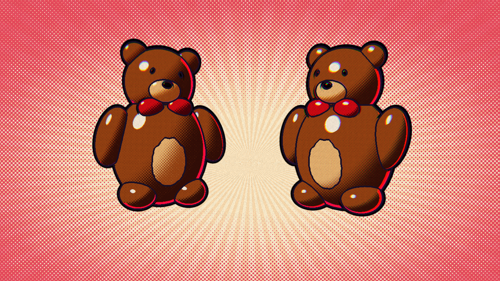

# ADR 0001 — Tech stack

**Status:** Accepted · 2026-11-06

## Context

A browser creature-collector with turn-based "contests", skill minigames, and an
over-the-top comic presentation (Spider-Verse halftone/misregistration, panel
splits, slow-mo, big lettering). Deploys to Vercel as static files. No backend;
persistence is local. Must be playable with one keyboard by two people.

## Spikes (code in `/spikes`, run with `npm run dev` → `/spikes/<name>/`)

| Spike | Question | Result |
|---|---|---|
| `render` | Can Three.js do cel bands + screen-space halftone + ink lines + CMY misregistration + animation "on twos"? | **Yes.** Custom `ShaderMaterial` (3 bands, rotated dot screen in shadow, colored rim). Inverted-hull silhouettes (5px) + ID-buffer edge pass for inner lines (2px) gives inked line-weight variation. Post pass does misregistration, paper grain, halftone backdrop. Two-camera diagonal **panel split** composited in the same post pass. CPU cost **≈0.7 ms/frame** (60 draw calls). GPU numbers in this container are SwiftShader software raster (80–110 ms) and are not representative; workload is ~3 scene passes + 1 full-screen pass, trivial for any integrated GPU. |
| `type` | Which faces give "fun *and* classy"? | **Bangers** = the loud voice (callouts, onomatopoeia). **Fraunces** = the narrator (UI, names, captions, logo; 900 italic for display). Five other candidates rejected — two families is the edit. |
| `input` | Is keyboard timing precise enough for a rhythm minigame? | **Yes.** `KeyboardEvent.timeStamp` shares the `performance.now()` clock; handler lag ≤1.6 ms; rAF steady 16.7 ms. Judge with event timestamps; windows ±55 ms (perfect) / ±120 ms (good) absorb display + keyboard latency. |

## Decision

- **Vite + TypeScript (strict)** — fast dev loop, static output for Vercel.
- **Three.js (WebGL2)** for the stage — toys are literally built from primitives
  (spheres, cylinders, boxes), so 3D-from-code is cheaper than hand-drawn 2D
  and gets camera moves (dolly, dutch, push-in) for free. Custom comic
  materials + a single hand-written post pass; no EffectComposer.
- **Preact** for UI screens/HUD as a DOM layer over the canvas — CSS is the best
  tool for lettering (stroke, misprint shadows, skew).
- **Pure TS core** (`src/core`) with zero DOM/Three imports: battle rules, data,
  AI, progression, save schema. Deterministic seeded RNG → unit-testable and
  simulatable for balance.
- **WebAudio synthesis** for SFX — no asset pipeline, no licensing. No music.
- **localStorage** with a versioned, validated save schema. No Supabase/backend.
- **Vitest** (unit) + **Playwright** (e2e smoke) + ESLint/Prettier + GitHub Actions.
- Fonts self-hosted via `@fontsource` (OFL) — no third-party requests at runtime.

## Consequences

- One rendering idiom for everything 3D: if a toy looks wrong, it's a model or
  a palette problem, not a pipeline problem.
- Two-player is local only (shared keyboard). Online play would need a relay;
  out of scope.
- Low-end devices: expose a "reduce effects" setting that drops the ID pass and
  misregistration, and respects `prefers-reduced-motion` for flashes/shake.
